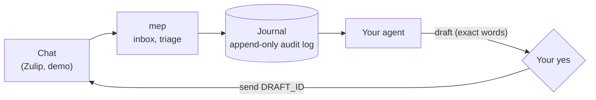

# miseenplace

**Every ask, in its place.** An agent-native CLI and set of skills that lay out the asks, promises and nudges from your chat before the day starts: a chef's mise en place for your workday, for Claude Code, Codex, Gemini CLI and Cursor.

[](https://ankitkpandey1.github.io/miseenplace/)
[](https://pypi.org/project/miseenplace-cli/)
[](https://github.com/ankitkpandey1/miseenplace/actions/workflows/ci.yml)
[](LICENSE)
[](https://pypi.org/project/miseenplace-cli/)

[Docs](https://ankitkpandey1.github.io/miseenplace/) · [Quickstart](docs/quickstart.md) · [CLI](docs/cli.md) · [Changelog](CHANGELOG.md)


## Paste this into your agent

```text
Install miseenplace with `uv tool install miseenplace-cli`, run `miseenplace skills --install DIR`
with the skills directory for your tool, then run the setup skill and follow it. Ask me only for things you cannot find out yourself.
```

No account? `uvx --from miseenplace-cli mep demo` runs a two-minute tour on fictional data.

### Where the skills go

| Tool | Skills directory (user level) | Project level |
|---|---|---|
| Claude Code | `~/.claude/skills/` | `.claude/skills/` |
| Codex | `~/.agents/skills/` | `.agents/skills/` |
| Gemini CLI | `~/.gemini/skills/` (alias `~/.agents/skills/`) | `.gemini/skills/` |
| Cursor | `~/.cursor/skills/` (also reads `~/.agents/skills/`) | `.cursor/skills/` |

Paths are from each tool's documentation at the time of writing; if your version differs, check your tool's docs.
Copy the bundled skills with the directory for your tool (Claude Code shown). `mep` remembers the directory and refreshes the copies when it updates:

```bash
mep skills --install ~/.claude/skills
```

Claude Code can also install it as a plugin, with no copying:

```text
/plugin marketplace add ankitkpandey1/miseenplace
/plugin install miseenplace@miseenplace
```

## Why

Chat is where work is asked for and promised, and it scrolls away. To-do apps start empty and trust you to copy things in. miseenplace reads your chat, keeps only what needs you, and turns it into an audit-logged action list your agent can drive.

- **One line per ask.** `mep inbox` shows `id · who · where · ask · action`, nothing else. Your own earlier answers hide the asks you already handled. Real output from `mep demo`:

  ```text
  3 · Rowan Hale · DM: Rowan Hale · Could you review the parser PR when you get a chance? It blocks the beta. · todo
  4 · Sam Okafor · #platform > incident follow… · @Jordan Rivers can you write up the retro for yesterday's outage by Friday? · todo
  5 · Alex Chen · #platform > release 2.4 · Changelog still pending, ETA? · reply
  ```
- **One call per decision.** `mep triage 12 --todo` files the item with link, topic and context filled in.
- **Agents cannot post free text.** `draft` stores the exact words; `send` takes only a draft id, after you said yes to that text.
- **Cheap to run.** The CLI does the deterministic work, so a small model can drive it. A tested output budget keeps a ten-message loop near 500 tokens.
- **Your data, your storage.** Local files, a private git repository, or a backend you write in 30 minutes.
- **Stdlib only.** No runtime dependencies. Python 3.11 to 3.14.

| | Plain to-do app | miseenplace |
|---|---|---|
| Captures asks from chat | you copy them in | reads the chat |
| Remembers you already answered | no | hides answered asks |
| History | edits overwrite | append-only audit log, replay-validated |
| Agent can drive it | via a UI or an API | terse CLI plus short skills |
| Agent can post for you | n/a | only a stored draft you approved |
| Where data lives | the vendor | files you own, optionally in git |

## How it works



The CLI reads the chat and does the bookkeeping. The agent reads the short list and writes to the journal. A reply is only a stored draft until you say yes to that exact text.

## Daily use

```bash
mep inbox                               # only what needs you
mep triage 12 --todo --eta fri          # journal it
mep triage 13 --reply-draft "Thursday"  # stores the text, posts nothing
mep send d1a2b3c4e                      # after your yes on that exact text
mep top                                 # what first
mep standup --since yesterday           # Did / Next / Waiting on
mep watch                               # block until something needs you
```

## Skills

`skills/` follows the Agent Skills standard and also installs as a Claude Code plugin (`.claude-plugin/`).

| Skill | Does |
|---|---|
| `setup` | install, connect a source, verify |
| `journal` | keep items and the work diary |
| `inbox-triage` | inbox into journal items and drafted replies |
| `inbox-watch` | background watcher; wakes the agent on new asks |
| `learn-style` | learns how you write so drafts sound like you |

## Storage

```toml
# config.toml in the data root
[storage]
backend = "git"      # local (default) | git | "package.module:ClassName"
remote = "git@host:me/my-data.git"
```

The git backend pulls before reads and commits and pushes after writes; a failed push is an error. See [writing a storage backend](docs/writing-a-storage-backend.md).

## Sources

Zulip and a demo source ship today. A new one takes about 30 minutes: [writing a source](docs/writing-a-source.md).

## Status and roadmap

Alpha. The commands and file formats can still change between 0.x releases; the changelog says when.

- Ships today: Zulip and the demo source, local and git storage, five skills.
- Wanted: Slack, GitHub notifications and email as sources. Start with [writing a source](docs/writing-a-source.md) and [CONTRIBUTING.md](CONTRIBUTING.md), and open an issue with the `new-source` template first if you want feedback on the design.

## Updates

`mep` checks PyPI at most once a day, in a background process that never delays your command. If a newer version exists and it was installed with `uv tool` or `pipx`, it upgrades itself; the new version applies on the next run, and skills copied with `mep skills --install` are refreshed on an auto-update or `mep update`. Any other install (a virtual environment, system Python, a checkout) only gets a notice: one line to stderr, once a day: `miseenplace X.Y.Z is available: <upgrade command>`.

- Check and upgrade now: `mep update`. If you upgrade by hand (`uv tool upgrade miseenplace-cli`), run `mep skills --refresh` afterwards to refresh the copied skills.
- Turn it off: `MISEENPLACE_DISABLE_AUTOUPDATE=1`, or `auto_update = false` in `config.toml`.
- It does not run when stderr is not a terminal, when `CI` is set, or for `mep send`.

## Uninstall

```bash
uv tool uninstall miseenplace-cli       # or: pipx uninstall miseenplace-cli
rm -r ~/.claude/skills/{setup,journal,inbox-triage,inbox-watch,learn-style}   # skills you copied
```

Your data root (`$MISEENPLACE_DIR`, else `~/.local/share/miseenplace`) holds your journal, drafts and style file. It is yours: keep it, or delete it. Uninstalling never touches it. The update state lives in `~/.cache/miseenplace` and is safe to delete.

## Your data is personal

The journal, your sent-message archive, your style file and a verbatim log of your requests live in your data root, never in this repository. Read [security](docs/security.md), especially what the consent gate does not guarantee.

## Docs

[Quickstart](docs/quickstart.md) · [Concepts](docs/concepts.md) · [CLI](docs/cli.md) · [Data model](docs/data-model.md) · [Sources](docs/sources.md) · [Agent cost](docs/agent-cost.md) · [Security](docs/security.md) · [Contributing](CONTRIBUTING.md)

Apache-2.0.
